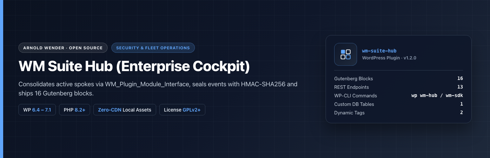
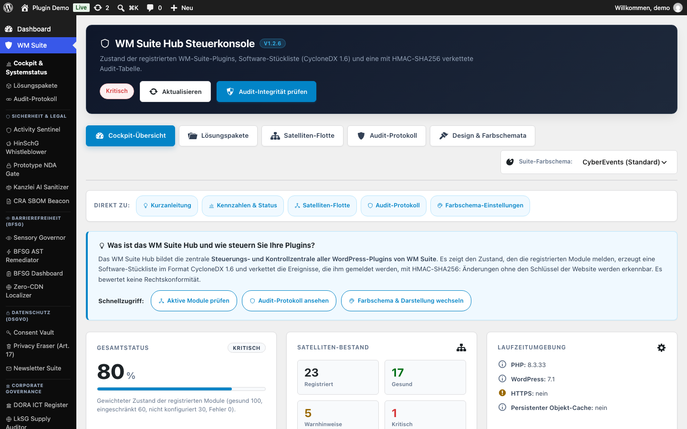
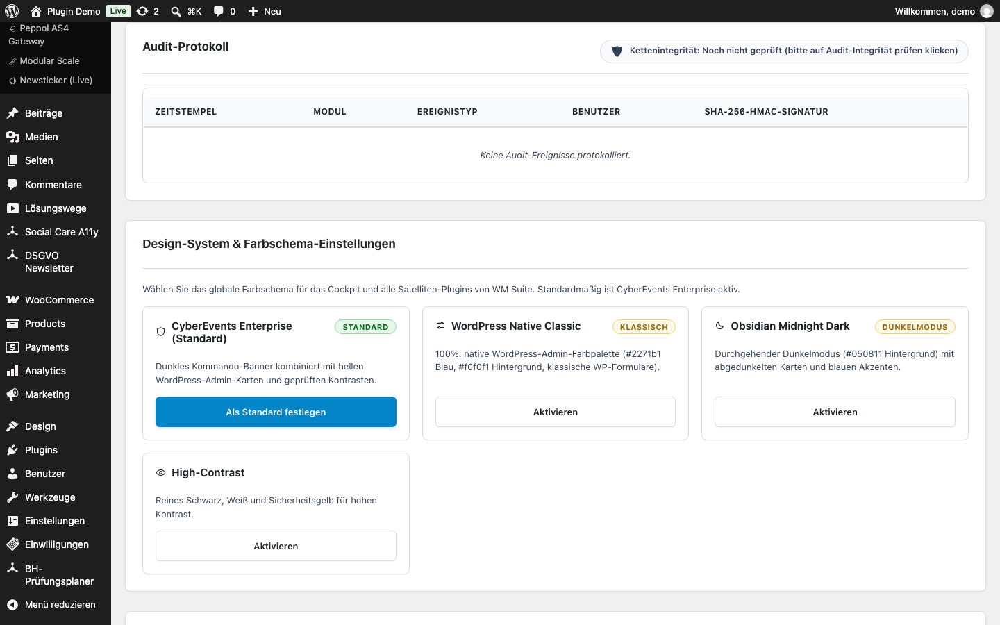
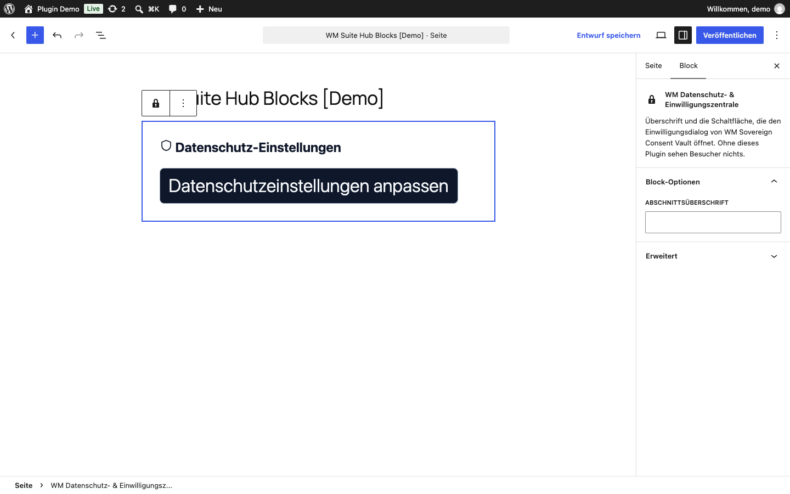
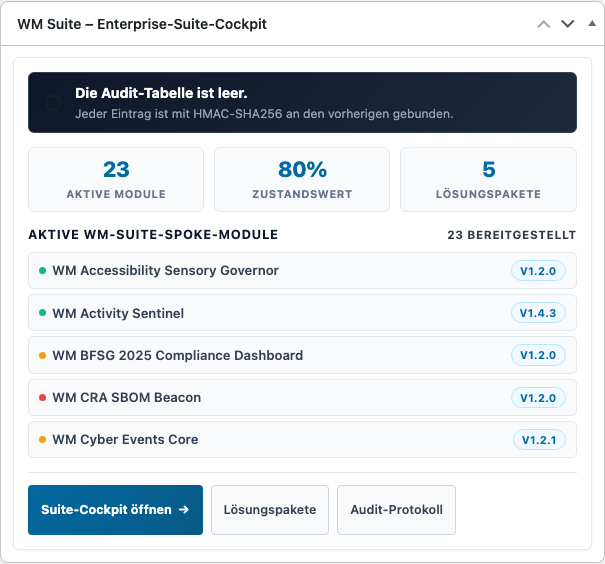

# WM Suite Hub (Deutsche Dokumentation)

<p align="center">
  <a href="README.md"></a>
  <a href="README.de.md"></a>
  <a href="README.es.md"></a>
</p>

> **Zentrales Cockpit der WM-Suite-Plugin-Familie: Verzeichnis der Spokes, Statusmatrix, Append-only-HMAC-SHA256-Kette in einer Tabelle, 16 kompilierte und serverseitig gerenderte Gutenberg-Blöcke, Block-Bindings- und GenerateBlocks-2.x-Brücken, eine Borlabs-Cookie-Brücke und ein Auflöser für Lösungspakete, dessen Installation mit 501 antwortet**  
> **Plugin-Seite:** [https://arnoldwender.com/wordpress-plugins/wm-suite-hub/](https://arnoldwender.com/wordpress-plugins/wm-suite-hub/)  
> **Mit einem agentischen Workflow entwickelt:** entstanden mit KI-Coding-Agenten. Prüfen und testen Sie es wie jeden fremden Code, bevor Sie es produktiv einsetzen.  
> **Support & Haftung:** Kein Support (Zero Support) — reproduzierbare Bugs ausschließlich über [GitHub Issues](https://github.com/arnoldwender/wm-wp-suite-hub/issues) · kein privater Support · OHNE GEWÄHR („AS IS“) / keine Haftung ([SUPPORT.md](SUPPORT.md))

> Diese Datei beschreibt, was das Plugin ausliefert. Bis zum 2026-09-16 nannte sie einen nicht registrierten Shortcode `wm_suite_cockpit` mit `theme`-Attribut, die WP-CLI-Befehle `wp suite status|verify|export`, REST-Routen `/wp-json/wm-suite/v1/status` `/submit` `/export`, GoBD-Prüfberichte als PDF oder CSV, drei Tabellen, drei Entwickler-Hooks und pauschale Konformitätszusagen zu CRA Art. 14, DORA, HinSchG und GoBD sowie den Urteilen Planet49 und LG München I. Nichts davon existiert in diesem Repository (gemessen: `add_shortcode` kommt nirgends vor, die Befehle heißen `wp wm-hub` und `wp wm-sdk`, der REST-Namensraum ist `wm-hub/v1` (dazu `wm-suite/v1/consent-sync`, wenn Borlabs Cookie aktiv ist), es gibt keinen Export und genau **eine** Tabelle). Das Plugin trifft keine rechtliche Bewertung.

---

## Live-Vorschau



| Cockpit | Audit-Log | Gutenberg-Block (`wm/privacy-center`) | Dashboard-Widget |
| --- | --- | --- | --- |
|  |  |  |  |
| WM-Suite-Cockpit: Zustand der registrierten Plugins, Laufzeitumgebung und Theme-Umschalter | Audit-Log: Einträge der registrierten Plugins, jeder mit HMAC-SHA256 an den vorherigen gebunden | Gutenberg-Editor mit einem der 16 serverseitigen Hub-Blöcke (wm/privacy-center) | WordPress-Dashboard-Widget: registrierte Module mit dem Zustand, den jedes meldet |

---

## Was das Plugin leistet

1. **Verzeichnis der Spokes:** Jedes WM-Suite-Plugin meldet sich über den Filter `wm_register_suite_module` oder seinen Alias `wm_suite_hub_registered_modules`; `Module_Registry` führt beide Listen zusammen, behält die Objekte, die `WM_Plugin_Module_Interface` erfüllen, und verwirft den Rest. `Health_Matrix` rechnet deren `get_health_status()` in eine Kennzahl um und legt sie in einem Transient ab.
2. **Cockpit:** Menü *WM Suite* (`admin.php?page=wm-suite-hub`, Berechtigung `manage_wm_suite`, bei der Aktivierung an Administratoren vergeben, zusammen mit der Rolle `wm_compliance_officer`), zwei Dashboard-Widgets und eine zusammengefasste Seitenleiste: Bei aktivem Hub wird das eigene Menü eines Spokes entfernt und vom Hub aus aufgerufen. Statusanzeige und Modulzustände sind die Werte der Statusmatrix als übersetzte Wörter (*Gesund*, *Eingeschränkt*, …; ein unbekannter Zustand heißt *Unbekannt*), und die Karte *Laufzeitumgebung* zeigt PHP- und WordPress-Version, HTTPS und Objekt-Cache so, wie die Matrix sie gelesen hat — nur fehlendes HTTPS trägt eine Warnung.
3. **Protokollkette:** Eine Tabelle, `{prefix}wm_suite_audit_log` (`timestamp`, `module_slug`, `event_type`, `user_id`, `ip_address`, `payload`, `previous_hash`, `current_hash`). Jedes Ereignis wird mit `HMAC-SHA256( timestamp|module|event|user|ip|payload|previous_hash, wp_salt( 'auth' ) )` linear verkettet; `verify_chain_integrity()` geht die Zeilen in Seiten zu 500 durch und nennt die erste, deren Verkettung oder Signatur nicht neu berechnet werden kann. Eine falsche Signatur heißt: Die Zeile wurde geändert, oder der Schlüssel der Website (`AUTH_SALT`) ist nicht mehr der, mit dem sie geschrieben wurde — die Meldung nennt beides. Erkannt werden Änderungen ohne den Schlüssel der Website — nicht, ob eine Zeile wahr ist.
4. **Lösungspakete:** Manifeste werden gelesen, ihr Abhängigkeitsgraph mit Kahns topologischer Sortierung aufgelöst und die Umgebung vorab geprüft. `dry_run` gibt die Reihenfolge zurück. **Installieren gibt es in dieser Version nicht:** `POST /marketplace/install-bundle` ohne `dry_run` antwortet `501` und schreibt nichts, weil der Signaturschlüssel eine offene Entscheidung ist (D9).
5. **Gutenberg & dynamische Bindungen:** 16 serverseitig gerenderte Blöcke (`block.json`, `apiVersion` 3, `editorScript: wm-suite-hub-blocks-editor` in `build/index.js`) in der Kategorie `wm-suite`, dazu die WordPress-6.5+-Block-Bindings-Quelle `wm-suite-hub/telemetry` und das GenerateBlocks-2.x-Dynamic-Tag `wm_hub_telemetry` (leer, wenn der Hub einen Wert nicht berechnen kann). Kein Block prüft, was er zeigt: Vier zeigen über ihren Shortcode die Ausgabe eines anderen WM-Suite-Plugins, `wm/consent-badge` öffnet den Einwilligungsdialog dieses Consent Vault, `wm/event-grid` listet die aktiven Events von WM Cyber Events Core (`CyberEvents_Database::get_active_events()`), und die übrigen zehn geben die im Editor eingetragenen Werte aus. 13 Blöcke bleiben für Besucher leer, solange ihr Plugin fehlt oder eine Pflichtangabe leer ist; Redakteure sehen stattdessen, was fehlt. Jeder Block mit seinen Attributen: **[docs/BLOCKS.md](docs/BLOCKS.md)** (Englisch).
6. **Borlabs-Cookie-Brücke:** REST-Route und Frontend-Skript werden nur registriert, wenn Borlabs Cookie erkannt wird. Speichert ein Besucher im Borlabs-Dialog eine Entscheidung (Ereignis `borlabs-cookie-consent-saved`), ruft das Skript `POST /wp-json/wm-suite/v1/consent-sync` auf; hinter REST-Token und einer Grenze von 10 Anfragen pro Minute je Client liest die Route die Entscheidung aus dem Cookie `borlabs-cookie`, das die Anfrage mitbringt — die akzeptierten Dienstgruppen mit ihren Diensten und die eigene Consent-ID von Borlabs — und schreibt einen Eintrag mit anonymisierter IP und begrenzter Browserkennung (höchstens 50 Gruppen mit je höchstens 50 Diensten). Ohne lesbare Entscheidung schreibt sie nichts und antwortet `400`. Borlabs selbst konfiguriert sie nicht: Dort werden keine Dienste, Content Blocker oder Texte registriert. Gemessen an Borlabs Cookie 3.4; der Ereignisname für 2.x ist nicht geprüft. Der Filter `wm_compliance_has_consent` liest dasselbe Cookie, wenn WM Sovereign Consent Vault nicht aktiv ist: Eine Kategorie ist eine Borlabs-Dienstgruppe (`external_media` trifft auch `external-media`) oder ein einzelner Dienst.
7. **Asset-Deduplizierung:** Laden zwei Plugins dasselbe Familien-Stylesheet, bleibt nur das kanonische; die alte Kopie eines Spokes wird nur entfernt, solange `wm-admin-ui` auf der Seite ist.
8. **Design-Familie:** `assets/css/wm-admin-tokens.css` und `assets/css/wm-admin-ui.css` sind hier kanonisch; `wp-plugin-fleet-ui-sync.py` verteilt sie in jedes Plugin und schreibt dort `tests/test-ui-family.php`, das ihre MD5 festnagelt.
9. **Opt-in-Deinstallation:** Standardmäßig (`wm_suite_hub_delete_data_on_uninstall = false`) bewahrt `uninstall.php` die Protokolltabelle, Rollen und Optionen auf; erst nach expliziter Freigabe im Cockpit werden alle Daten bei der Deinstallation gelöscht.

### Nicht enthalten

Kein Shortcode; kein PDF- oder CSV-Export; keine öffentliche REST-Route außer der Einwilligungsbrücke; keine zweite oder dritte Tabelle; keine Paketinstallation; keine rechtliche Bewertung; keine ausgehende Anfrage.

---

## Schnellstart

1. Installieren und aktivieren (WordPress 6.4+, PHP 8.2+). Die Aktivierung legt die Protokolltabelle an, vergibt `manage_wm_suite` an Administratoren und registriert die Rolle `wm_compliance_officer`. In Multisite-Netzwerken richtet `wp_initialize_site` bei Netzwerkaktivierung neue Unterseiten automatisch ein.
2. **WM Suite > Suite Hub** öffnen: aktive Spokes erscheinen von selbst.
3. Optional Borlabs Cookie aktivieren, damit die Einwilligungsbrücke registriert wird.

---

## Befehlszeile

```bash
wp wm-hub status [--format=json] [--force]
wp wm-hub sbom [--output=<datei>]
wp wm-hub crypto-verify
wp wm-hub flush-cache
wp wm-hub action <slug> <aktion> [--params=<json>]
wp wm-hub bundle list|install <id> [--dry-run]
wp wm-hub package verify-signatures
wp wm-hub deduplicate-telemetry

wp wm-sdk status [--format=json]
wp wm-sdk scaffold --slug=<slug> [--name=<name>] [--domains=<liste>] [--output=<datei>]
wp wm-sdk test-event --event=<name> [--severity=<stufe>] [--module=<slug>]
wp wm-sdk sanitize --text=<text>
```

`WM_Hub_CLI::register()` und `WM_SDK_CLI::register()` registrieren die Unterbefehle mit expliziten `@subcommand`-Annotationen (`crypto-verify`, `flush-cache`, `deduplicate-telemetry`, `test-event`), und `tests/test-suite.php` prüft jeden hier genannten Unterbefehl gegen die Klassen.

WP-CLI läuft ohne Benutzer: Diese Befehle stehen jedem offen, der auf dem Server `wp` ausführen darf.

---

## REST

Unter `/wp-json/wm-hub/v1`, alle mit der Berechtigung `manage_wm_suite`: `fleet/status`, `fleet/metrics`, `audit/logs`, `audit/verify`, `settings/theme`, `settings/lifecycle`, `marketplace/bundles`, `marketplace/preflight`, `marketplace/install-bundle` (501 ohne `dry_run`), `marketplace/telemetry`, `cache/flush` sowie `module/<slug>/action`. Dazu `POST /wp-json/wm-suite/v1/consent-sync` nur mit aktivem Borlabs Cookie.

Klassen, Hooks, Tabellenschema und der Spoke-Vertrag: **[DEVELOPERS.md](DEVELOPERS.md)** · gemessene Flottenarchitektur: **docs/ARCHITECTURE-2026-11-16.md**.

```bash
php tests/test-suite.php
php tests/test-pot-freshness.php
bash tests/run-mutations.sh
```

### Versions- und Architekturstand (`v1.2.6`)

- Version `1.2.6` ist über Plugin-Header und `WM_SUITE_HUB_VERSION`, `readme.txt`, `CHANGELOG.md`, `SECURITY.md`, `bom.json`, `llms.txt` und alle 16 `block.json`-Manifeste synchronisiert; die Lizenz `GPLv2 or later` (`GPL-2.0-or-later`) steht zusätzlich in `composer.json`, das keine Version führt.
- `languages/` enthält 25 kompilierte `.po`-, `.mo`- und JED-`.json`-Sprachpakete (`348` Einträge in `languages/wm-suite-hub.pot`).
- `docs/ARCHITECTURE-2026-08-29.md` bleibt mit einem ausdrücklichen Hinweis als historischer Beleg jenes Datums erhalten; maßgeblich ist **docs/ARCHITECTURE-2026-11-16.md**.

---

## Konformität

- **Was das Plugin feststellt:** welche WM-Suite-Plugins aktiv sind und welchen Zustand sie melden, und dass die Zeilen seiner eigenen Protokolltabelle ohne den Schlüssel der Website nicht geändert, entfernt oder umsortiert wurden. Es bewertet weder DSGVO, TDDDG, CRA, DORA, HinSchG noch GoBD und macht keine Website konform.
- **Ausgehende Anfragen:** keine.
- **Personenbezogene Daten:** die Protokolltabelle speichert Benutzer-ID, IP-Adresse (bei der Einwilligungsbrücke anonymisiert) und die Nutzlast des jeweiligen Ereignisses; nichts verlässt die Website.

---

## Lizenz

Vertrieben unter der **GNU General Public License v2 oder neuer** (`GPL-2.0-or-later`).  
Copyright (C) 2026 Arnold Wender. Alle Rechte vorbehalten.  
