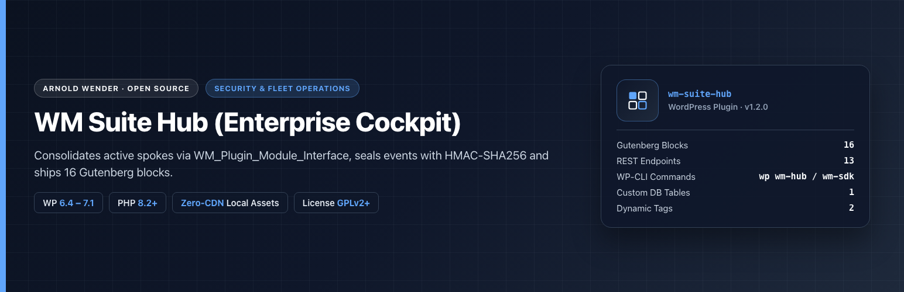
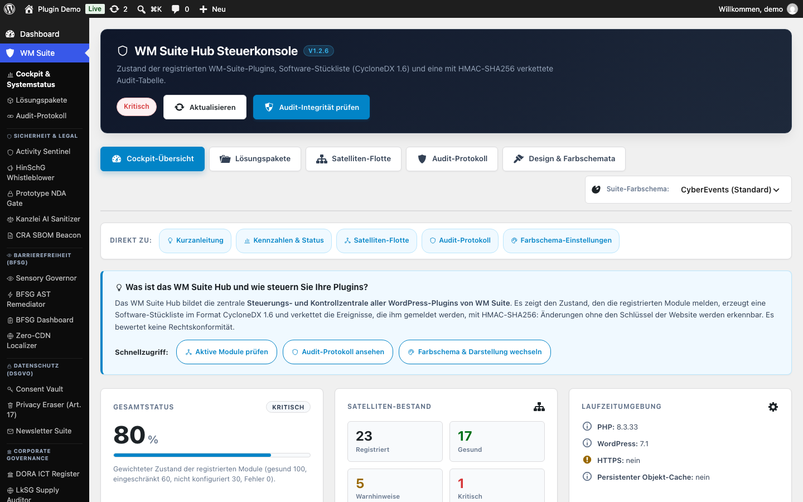
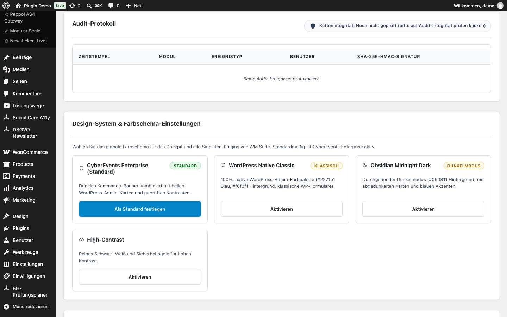
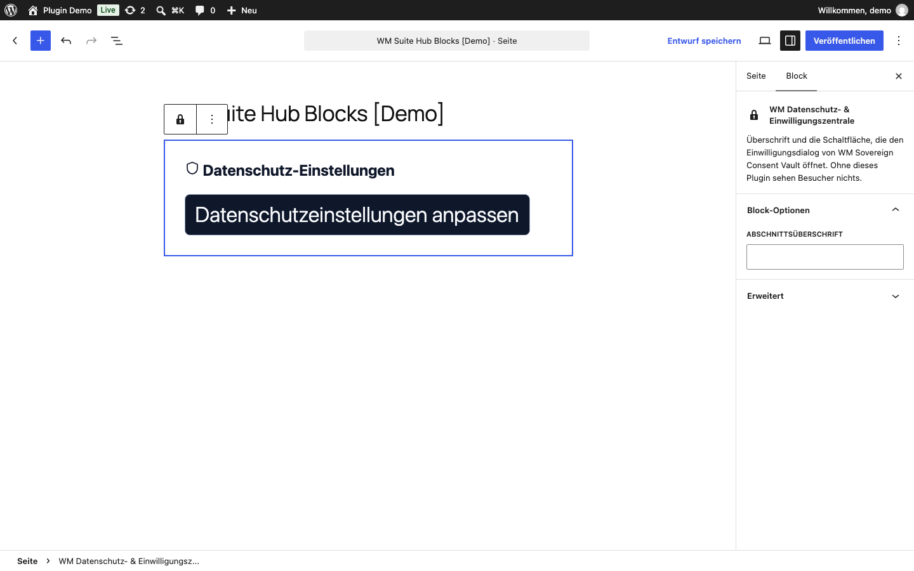
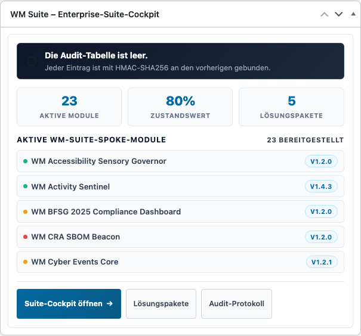

# WM Suite Hub (Documentación en Español)

<p align="center">
  <a href="README.md"></a>
  <a href="README.de.md"></a>
  <a href="README.es.md"></a>
</p>

> **Cabina central de la familia de plugins de WM Suite: registro de spokes, matriz de salud, cadena append-only HMAC-SHA256 en una sola tabla, 16 bloques de Gutenberg compilados y renderizados en el servidor, puentes Block Bindings y GenerateBlocks 2.x, un puente para Borlabs Cookie y un resolutor de paquetes cuya instalación responde 501**  
> **Página del Plugin:** [https://arnoldwender.com/es/plugins-wordpress/wm-suite-hub/](https://arnoldwender.com/es/plugins-wordpress/wm-suite-hub/)  
> **Desarrollado con un agentic workflow:** creado con agentes de programación de IA. Revísalo y pruébalo como cualquier código de terceros antes de usarlo en producción.  
> **Soporte y responsabilidad:** Cero soporte (Zero Support) — errores reproducibles únicamente en [GitHub Issues](https://github.com/arnoldwender/wm-wp-suite-hub/issues) · sin soporte privado · TAL CUAL («AS IS») / sin responsabilidad ([SUPPORT.md](SUPPORT.md))

> Este archivo describe lo que el plugin entrega. Hasta el 2026-09-16 mencionaba un shortcode no registrado `wm_suite_cockpit` con atributo `theme`, los comandos WP-CLI `wp suite status|verify|export`, rutas REST `/wp-json/wm-suite/v1/status` `/submit` `/export`, informes GoBD en PDF o CSV, tres tablas, tres hooks para desarrolladores y promesas generales de conformidad con CRA Art. 14, DORA, HinSchG y GoBD, más las sentencias Planet49 y LG München I. Nada de eso existe en este repositorio (medido: `add_shortcode` no aparece en ninguna parte, los comandos son `wp wm-hub` y `wp wm-sdk`, el espacio REST es `wm-hub/v1` (más `wm-suite/v1/consent-sync` con Borlabs Cookie activo), no hay exportación y existe **una** tabla). El plugin no hace ninguna evaluación legal.

---

## Capturas en vivo



| Cabina | Registro de auditoría | Bloque Gutenberg (`wm/privacy-center`) | Widget del Escritorio |
| --- | --- | --- | --- |
|  |  |  |  |
| Cabina de WM Suite: estado de los plugins registrados, entorno de ejecución y selector de tema | Registro de auditoría: entradas de los plugins registrados, cada una encadenada a la anterior con HMAC-SHA256 | Editor Gutenberg con uno de los 16 bloques renderizados en servidor del Hub | Widget del escritorio de WordPress: módulos registrados con el estado que informa cada uno |

---

## Qué hace el plugin

1. **Registro de spokes.** Cada plugin de WM Suite se ofrece por el filtro `wm_register_suite_module` o por su alias `wm_suite_hub_registered_modules`; `Module_Registry` une ambas listas, conserva los objetos que cumplen `WM_Plugin_Module_Interface` y descarta el resto. `Health_Matrix` convierte su `get_health_status()` en una puntuación y la guarda en un transient.
2. **Cabina.** Menú *WM Suite* (`admin.php?page=wm-suite-hub`, capacidad `manage_wm_suite`, concedida a los administradores en la activación junto con el rol `wm_compliance_officer`), dos widgets del escritorio y una barra lateral consolidada: con el hub activo, el menú propio de un spoke se retira y se sirve desde el hub. El indicador de estado y el estado de cada módulo son los valores de la matriz de salud como palabras traducidas (*Gesund*, *Eingeschränkt*, …; un estado desconocido se lee *Unbekannt*), y la tarjeta del entorno muestra las versiones de PHP y WordPress, HTTPS y la caché de objetos tal como la matriz las leyó; solo la falta de HTTPS lleva un aviso.
3. **Cadena de auditoría.** Una tabla, `{prefix}wm_suite_audit_log` (`timestamp`, `module_slug`, `event_type`, `user_id`, `ip_address`, `payload`, `previous_hash`, `current_hash`). Cada evento se encadena linealmente con `HMAC-SHA256( timestamp|module|event|user|ip|payload|previous_hash, wp_salt( 'auth' ) )`; `verify_chain_integrity()` recorre las filas en páginas de 500 y nombra la primera cuyo enlace o firma no vuelve a calcularse. Una firma que no cuadra significa que la fila se cambió o que la clave del sitio (`AUTH_SALT`) ya no es la que había al escribirla; el mensaje nombra las dos causas. Detecta cambios hechos sin la clave del sitio; no convierte una fila en verdadera.
4. **Paquetes de solución.** Se leen los manifiestos, se resuelve su grafo de dependencias con la ordenación topológica de Kahn y se audita el entorno. `dry_run` devuelve el orden. **Instalar no existe en esta versión:** `POST /marketplace/install-bundle` sin `dry_run` responde `501` y no escribe nada, porque la clave de firma es una decisión abierta (D9).
5. **Gutenberg y enlaces dinámicos.** 16 bloques renderizados en el servidor (`block.json`, `apiVersion` 3, `editorScript: wm-suite-hub-blocks-editor` en `build/index.js`) en la categoría `wm-suite`, junto con la fuente de Block Bindings `wm-suite-hub/telemetry` (WordPress 6.5+) y la etiqueta dinámica `wm_hub_telemetry` de GenerateBlocks 2.x (vacía cuando el hub no puede calcular un valor). Ningún bloque comprueba lo que muestra: cuatro muestran por su shortcode la salida de otro plugin de WM Suite, `wm/consent-badge` abre el diálogo de consentimiento de ese Consent Vault, `wm/event-grid` lista los eventos activos de WM Cyber Events Core (`CyberEvents_Database::get_active_events()`) y los diez restantes imprimen los valores escritos en el editor. 13 bloques no muestran nada a los visitantes mientras falte su plugin o un ajuste obligatorio, y a los editores les dicen qué falta. Cada bloque con sus atributos: **[docs/BLOCKS.md](docs/BLOCKS.md)** (en inglés).
6. **Puente de Borlabs Cookie.** Su ruta REST y su script de frontend solo se registran si se detecta Borlabs Cookie. Cuando un visitante guarda una decisión en el diálogo de Borlabs (evento `borlabs-cookie-consent-saved`), el script llama a `POST /wp-json/wm-suite/v1/consent-sync`; tras el nonce REST y un límite de 10 peticiones por minuto por cliente, la ruta lee la decisión de la cookie `borlabs-cookie` que trae la petición —los grupos de servicios aceptados con sus servicios y el id de consentimiento propio de Borlabs— y añade una entrada con una IP anonimizada y un user agent acotado (como mucho 50 grupos de como mucho 50 servicios). Sin una decisión legible no escribe nada y responde `400`. No configura Borlabs: allí no registra servicios, bloqueadores de contenido ni textos. Medido con Borlabs Cookie 3.4; el nombre del evento de la 2.x no está verificado. El filtro `wm_compliance_has_consent` lee la misma cookie cuando WM Sovereign Consent Vault no está activo: una categoría es un grupo de servicios de Borlabs (`external_media` también vale como `external-media`) o un servicio concreto.
7. **Deduplicación de recursos.** Si dos plugins encolan la misma hoja de la familia, queda solo la canónica; la copia antigua de un spoke se retira únicamente mientras `wm-admin-ui` está en la página.
8. **Familia de diseño.** `assets/css/wm-admin-tokens.css` y `assets/css/wm-admin-ui.css` son canónicas aquí; `wp-plugin-fleet-ui-sync.py` las propaga a cada plugin y escribe allí `tests/test-ui-family.php`, que fija su MD5.
9. **Desinstalación opt-in.** Por defecto (`wm_suite_hub_delete_data_on_uninstall = false`), `uninstall.php` conserva la tabla de auditoría, los roles y las opciones; solo purga los datos cuando se habilita explícitamente en la cabina.

### No incluido

Ningún shortcode; ninguna exportación PDF ni CSV; ninguna ruta REST pública salvo el puente de consentimiento; ninguna segunda o tercera tabla; ninguna instalación de paquetes; ninguna evaluación legal; ninguna petición saliente.

---

## Inicio rápido

1. Instala y activa (WordPress 6.4+, PHP 8.2+). La activación crea la tabla de auditoría, concede `manage_wm_suite` a los administradores y registra el rol `wm_compliance_officer`. En redes Multisite activadas en red, `wp_initialize_site` aprovisiona automáticamente los nuevos subsitios.
2. Abre **WM Suite > Suite Hub**: los spokes activos aparecen solos.
3. Opcional: activa Borlabs Cookie para que se registre el puente de consentimiento.

---

## Línea de comandos

```bash
wp wm-hub status [--format=json] [--force]
wp wm-hub sbom [--output=<archivo>]
wp wm-hub crypto-verify
wp wm-hub flush-cache
wp wm-hub action <slug> <acción> [--params=<json>]
wp wm-hub bundle list|install <id> [--dry-run]
wp wm-hub package verify-signatures
wp wm-hub deduplicate-telemetry

wp wm-sdk status [--format=json]
wp wm-sdk scaffold --slug=<slug> [--name=<nombre>] [--domains=<lista>] [--output=<archivo>]
wp wm-sdk test-event --event=<nombre> [--severity=<nivel>] [--module=<slug>]
wp wm-sdk sanitize --text=<texto>
```

`WM_Hub_CLI::register()` y `WM_SDK_CLI::register()` registran los subcomandos con anotaciones explícitas `@subcommand` (`crypto-verify`, `flush-cache`, `deduplicate-telemetry`, `test-event`), y `tests/test-suite.php` comprueba contra las clases cada subcomando nombrado en estos documentos.

WP-CLI corre sin usuario: esos comandos están al alcance de quien pueda ejecutar `wp` en el servidor.

---

## REST

Bajo `/wp-json/wm-hub/v1`, todas con la capacidad `manage_wm_suite`: `fleet/status`, `fleet/metrics`, `audit/logs`, `audit/verify`, `settings/theme`, `settings/lifecycle`, `marketplace/bundles`, `marketplace/preflight`, `marketplace/install-bundle` (501 sin `dry_run`), `marketplace/telemetry`, `cache/flush` y `module/<slug>/action`. Además `POST /wp-json/wm-suite/v1/consent-sync`, solo con Borlabs Cookie activo.

Clases, hooks, esquema de la tabla y contrato de spoke: **[DEVELOPERS.md](DEVELOPERS.md)** · mapa medido de arquitectura de la flota: **docs/ARCHITECTURE-2026-11-16.md**.

```bash
php tests/test-suite.php
php tests/test-pot-freshness.php
bash tests/run-mutations.sh
```

### Estado de versión y arquitectura (`v1.2.6`)

- La versión `1.2.6` está sincronizada en la cabecera del plugin y `WM_SUITE_HUB_VERSION`, `readme.txt`, `CHANGELOG.md`, `SECURITY.md`, `bom.json`, `llms.txt` y los 16 manifiestos `block.json`; la licencia `GPLv2 or later` (`GPL-2.0-or-later`) figura además en `composer.json`, que no lleva versión.
- `languages/` incluye 25 catálogos compilados `.po`, `.mo` y JED `.json` (`348` entradas en `languages/wm-suite-hub.pot`).
- `docs/ARCHITECTURE-2026-08-29.md` se conserva con una nota explícita como registro histórico; la referencia vigente es **docs/ARCHITECTURE-2026-11-16.md**.

---

## Conformidad

- **Lo que establece el plugin:** qué plugins de WM Suite están activos y qué estado reportan, y que las filas de su propia tabla de auditoría no se cambiaron, borraron ni reordenaron sin la clave del sitio. No evalúa DSGVO, TDDDG, CRA, DORA, HinSchG ni GoBD, y no vuelve conforme a ningún sitio.
- **Peticiones salientes:** ninguna.
- **Datos personales:** la tabla de auditoría guarda el id de usuario, una dirección IP (anonimizada en el puente de consentimiento) y la carga de cada evento; nada sale del sitio.

---

## Licencia

Distribuido bajo licencia **GNU General Public License v2 o posterior** (`GPL-2.0-or-later`).  
Copyright (C) 2026 Arnold Wender. Todos los derechos reservados.  
