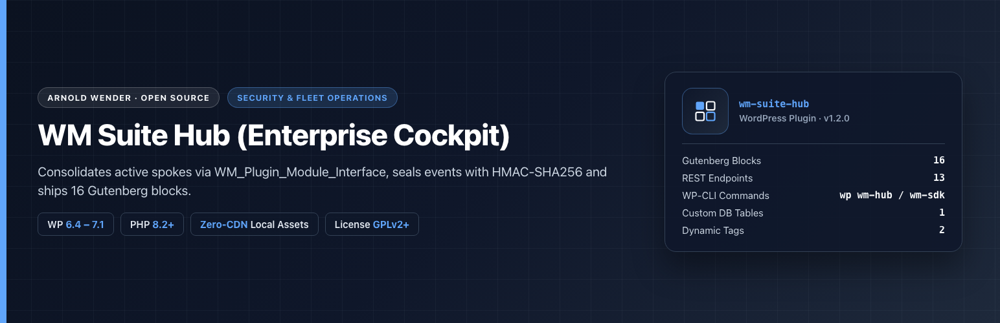
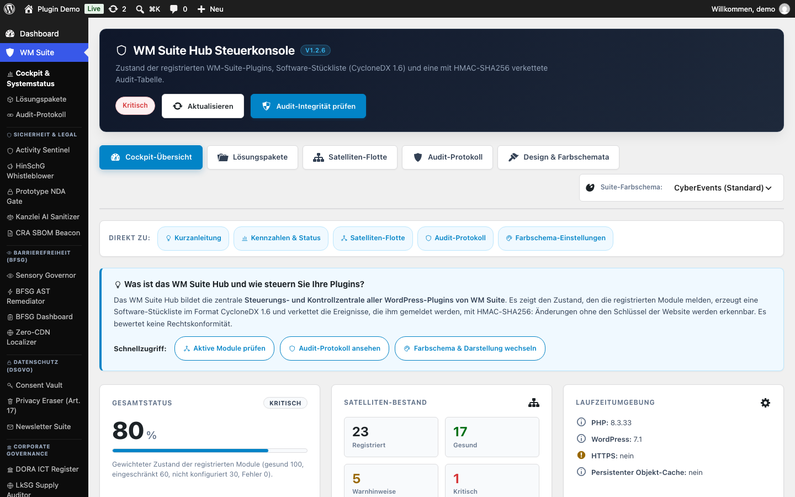
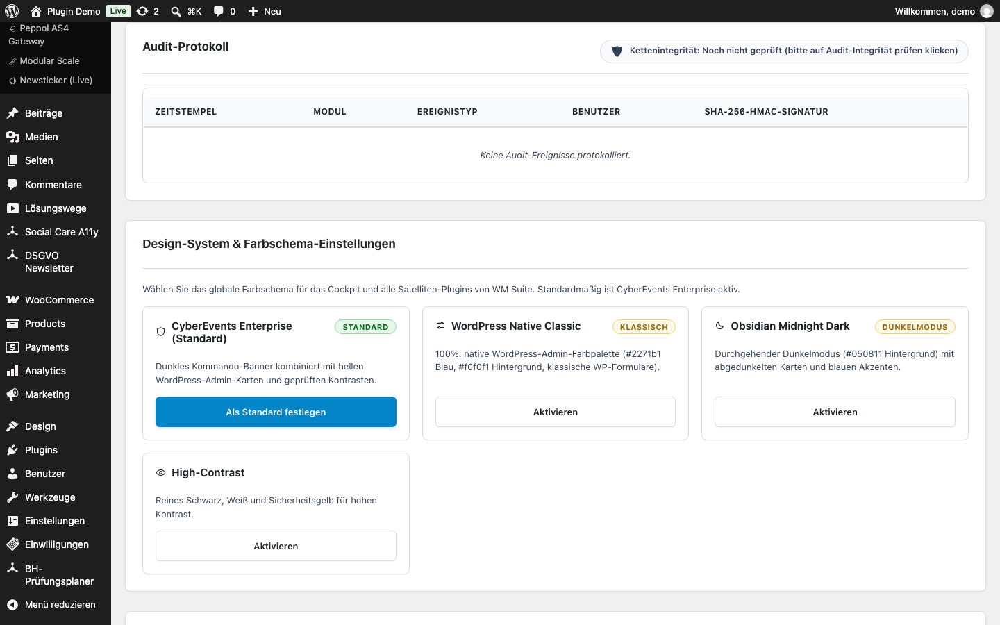
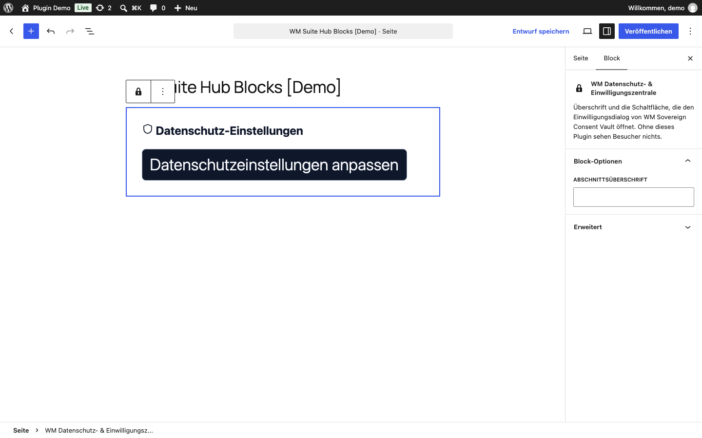
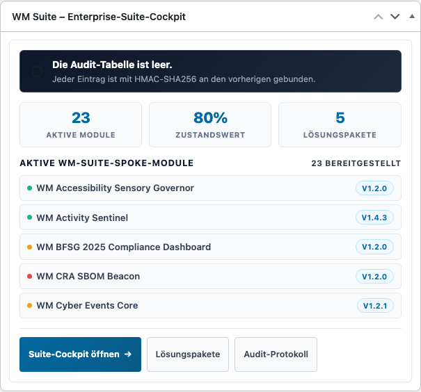

# WM Suite Hub

<p align="center">
  <a href="README.md"></a>
  <a href="README.de.md"></a>
  <a href="README.es.md"></a>
  <a href="#translated-documentation"></a>
  <a href="#translated-documentation"></a>
</p>

<p align="center">
  <a href="https://wordpress.org"></a>
  <a href="https://php.net"></a>
  <a href="https://www.gnu.org/licenses/gpl-2.0.html"></a>
</p>

> **Central cockpit for the WM Suite plugin family: a spoke registry, a health matrix, an append-only HMAC-SHA256 audit chain in one table, 16 compiled and server-rendered Gutenberg blocks, Block Bindings and GenerateBlocks 2.x telemetry bridges, a Borlabs Cookie bridge and a solution-pack resolver whose installer answers 501**  
> **Plugin Page:** [https://arnoldwender.com/wordpress-plugins/wm-suite-hub/](https://arnoldwender.com/wordpress-plugins/wm-suite-hub/)  
> **Built with an agentic workflow:** developed with AI coding agents. Review and test it like any third-party code before you use it in production.  
> **Support & Liability:** Zero support — reproducible bugs on [GitHub Issues](https://github.com/arnoldwender/wm-wp-suite-hub/issues) only · no private support · AS IS / no liability ([SUPPORT.md](SUPPORT.md))

> This README describes what the plugin ships. Until 2026-09-16 it described an unregistered `wm_suite_cockpit` shortcode with a `theme` attribute, WP-CLI commands `wp suite status` / `verify` / `export`, REST routes `/wp-json/wm-suite/v1/status` `/submit` `/export`, GoBD PDF and CSV audit exports, three database tables, three developer hooks, and statutory conformity promises for CRA Art. 14, DORA, HinSchG and GoBD plus the Planet49 and Munich font judgments. None of those exist in this repository (measured: `add_shortcode` does not exist anywhere, the commands are `wp wm-hub` and `wp wm-sdk`, the REST namespace is `wm-hub/v1` (plus `wm-suite/v1/consent-sync` when Borlabs Cookie is active), there is no export writer of any kind, there is exactly one table, and the hooks are the ones listed in [DEVELOPERS.md](DEVELOPERS.md)). The plugin makes no legal assessment.

---

## Live Screenshots



| Cockpit | Audit log | Gutenberg Block (`wm/privacy-center`) | Dashboard Widget |
| --- | --- | --- | --- |
|  |  |  |  |
| WM Suite cockpit: health of the registered plugins, runtime environment and theme switcher | Audit log: entries of the registered plugins, each chained to the previous one with HMAC-SHA256 | Gutenberg Block Editor displaying one of the 16 server-rendered Hub blocks (wm/privacy-center) | WordPress dashboard widget: registered modules with the health each reports |

---

## What the plugin does

1. **Spoke registry.** Every WM Suite plugin offers itself through the `wm_register_suite_module` filter or its alias `wm_suite_hub_registered_modules`; `Module_Registry` merges both lists, keeps the objects that implement `WM_Plugin_Module_Interface` and drops the rest. `Health_Matrix` turns their `get_health_status()` into a score, cached in a transient.
2. **Cockpit.** Menu *WM Suite* (`admin.php?page=wm-suite-hub`, capability `manage_wm_suite`, granted to administrators at activation together with the role `wm_compliance_officer`), two dashboard widgets, and a consolidated sidebar: with the hub active, a spoke's own top-level menu is removed and dispatched from the hub instead. The status badge and every module status are the health matrix's own values as translated words (*Gesund*, *Eingeschränkt*, …; an unknown status reads *Unbekannt*), and the runtime card shows the PHP and WordPress versions, HTTPS and the object cache as the matrix read them — only a missing HTTPS carries a warning.
3. **Audit chain.** One table, `{prefix}wm_suite_audit_log` (`timestamp`, `module_slug`, `event_type`, `user_id`, `ip_address`, `payload`, `previous_hash`, `current_hash`). Every event is appended to a linear chain with `HMAC-SHA256( timestamp|module|event|user|ip|payload|previous_hash, wp_salt( 'auth' ) )`; `verify_chain_integrity()` walks the rows in pages of 500 and names the first id whose link or signature does not recompute. A broken signature means the row was changed or the site key (`AUTH_SALT`) is no longer the one it was written with — the message names both. It detects changes made without the site key; it does not make a row true.
4. **Solution packs.** Bundle manifests are parsed, their dependency graph resolved with Kahn's topological sort, and a pre-flight audit checks the environment. `dry_run` returns the resolved order. **Installing is not available in this version:** `POST /marketplace/install-bundle` without `dry_run` answers `501` and writes nothing, because the signing root key is an open decision (D9).
5. **Gutenberg & dynamic bindings.** 16 server-rendered blocks (`block.json`, `apiVersion` 3, `editorScript: wm-suite-hub-blocks-editor` compiled in `build/index.js`) under the category `wm-suite`, registered with `register_block_type_from_metadata()` and live `ServerSideRender` previews. In addition, `Telemetry_Bridge` registers the WordPress 6.5+ Block Bindings source `wm-suite-hub/telemetry` and the GenerateBlocks 2.x Dynamic Tag `wm_hub_telemetry` exposing aggregate suite health score, active spoke count, status label, and hub version (empty when the hub cannot compute them). Each block, with its attributes and defaults: **[docs/BLOCKS.md](docs/BLOCKS.md)**. No block checks what it shows: four show the output of another WM Suite plugin through its shortcode and `wm/consent-badge` opens that consent vault's dialog, `wm/event-grid` lists the active events of WM Cyber Events Core (`CyberEvents_Database::get_active_events()`), and the other ten print the values typed into the editor. 13 render nothing for visitors while their plugin is missing or a required setting is empty, and tell editors what is missing.
6. **Borlabs Cookie bridge.** Its REST route and frontend script are registered only when Borlabs Cookie is detected. When a visitor saves a decision in the Borlabs dialog (event `borlabs-cookie-consent-saved`), the script calls `POST /wp-json/wm-suite/v1/consent-sync`; behind the REST nonce and a rate limit of 10 requests per minute per client, the route reads the decision from the `borlabs-cookie` cookie the request carries — the accepted service groups with their services, and Borlabs' own consent uid — and appends one entry with an anonymised IP and a bounded user agent (at most 50 groups of at most 50 services). Without a readable decision it writes nothing and answers `400`. It does not configure Borlabs: no services, content blockers or texts are registered there. Measured against Borlabs Cookie 3.4; the 2.x event name is not verified. The `wm_compliance_has_consent` filter reads the same cookie when WM Sovereign Consent Vault is not active: a category is a Borlabs service group (`external_media` also matches `external-media`) or a single service.
7. **Asset deduplication.** When two plugins enqueue the same family sheet, only the canonical one stays; a spoke's legacy `*-admin-obsidian` copy is dropped only while `wm-admin-ui` is on the page.
8. **Design family.** `assets/css/wm-admin-tokens.css` and `assets/css/wm-admin-ui.css` are the canonical sheets every WM plugin bundles byte-identically; `wp-plugin-fleet-ui-sync.py` propagates them and writes each plugin's `tests/test-ui-family.php`, which pins their MD5.

### Not shipped

No shortcode; no PDF or CSV export; no public REST route other than the Borlabs consent bridge; no second or third table; no bundle installation; no legal assessment of any kind; no outbound request to any host.

---

## Quick start

1. Install and activate (WordPress 6.4+, PHP 8.2+). Activation creates the audit table, grants `manage_wm_suite` to administrators and registers the `wm_compliance_officer` role. On Multisite networks, when network-activated, `wp_initialize_site` automatically provisions newly created sub-sites.
2. Open **WM Suite > Suite Hub**. Spokes active on the site appear by themselves.
3. Optional: activate Borlabs Cookie to register the consent bridge.

---

## Command line

```bash
wp wm-hub status [--format=json] [--force]     # health matrix of the registered spokes
wp wm-hub sbom [--output=<file>]               # CycloneDX 1.6 SBOM of the fleet
wp wm-hub crypto-verify                        # walks the audit chain, exits with an error on a break
wp wm-hub flush-cache                          # drops the telemetry transient
wp wm-hub action <slug> <action> [--params=<json>]
wp wm-hub bundle list|install <id> [--dry-run]
wp wm-hub package verify-signatures
wp wm-hub deduplicate-telemetry

wp wm-sdk status [--format=json]
wp wm-sdk scaffold --slug=<slug> [--name=<name>] [--domains=<list>] [--output=<file>]
wp wm-sdk test-event --event=<name> [--severity=<level>] [--module=<slug>]
wp wm-sdk sanitize --text=<string>
```

`WM_Hub_CLI::register()` and `WM_SDK_CLI::register()` register the commands with explicit `@subcommand` annotations (`crypto-verify`, `flush-cache`, `deduplicate-telemetry`, `test-event`), and `tests/test-suite.php` checks every subcommand named in these documents against the command classes.

WP-CLI runs with no user, so these commands are available to whoever can run `wp` on the server.

---

## REST

All routes below are under `/wp-json/wm-hub/v1` and require the capability `manage_wm_suite`:
`fleet/status`, `fleet/metrics`, `audit/logs`, `audit/verify`, `settings/theme`, `settings/lifecycle`, `marketplace/bundles`, `marketplace/preflight`, `marketplace/install-bundle` (501 without `dry_run`), `marketplace/telemetry`, `cache/flush`.

`POST /wp-json/wm-hub/v1/module/<slug>/action` dispatches an action to one registered spoke: `slug` is the module's slug in the registry, the body carries `action` (required, `sanitize_key`) and an optional `params` object. The hub calls `execute_action()` on the spoke, appends an `admin_action_executed` row to the audit chain with the action, its result and the user id, and answers `404` when the slug is not registered or its plugin is inactive, `500` with the exception message when the spoke throws. Which actions a slug accepts is defined by that spoke, not by the hub — `wp wm-hub action <slug> <action> [--params=<json>]` is the same call from the command line.

`POST /wp-json/wm-suite/v1/consent-sync` exists only with Borlabs Cookie active and is gated by the REST nonce and the rate limit described above. There is **no** `wm-suite/v1/sbom` route; the SBOM is written by `wp wm-hub sbom --output=<file>`.

---

## What the plugin stores outside its table

Four options, and nothing else:

| Option | Written by | Autoload | Meaning |
|---|---|---|---|
| `wm_suite_theme` | `POST /settings/theme` with `scope=global` ([API_Controller.php](src/API/API_Controller.php)) | no | the cockpit palette: `cyber-events` (default), `wp-native`, `obsidian-dark`, `high-contrast`. Any other value is rejected with `400`. |
| `wm_suite_hub_delete_data_on_uninstall` | `POST /settings/lifecycle` or the cockpit Lifecycle toggle | no | boolean (`false` by default). When `false`, uninstalling preserves the audit table, capabilities, and options; when `true`, `uninstall.php` purges them. |
| `wm_suite_hub_version` | activation, once ([Activator.php](src/Setup/Activator.php)) | no | the version that created the schema; it is **not** rewritten on upgrade, so it records the first install |
| `wm_suite_hub_activated_at` | activation, once | no | `current_time('mysql')` of the first activation |

`POST /settings/theme` with `scope=user` writes the user meta `wm_suite_theme` instead, which takes precedence over the option for that user. `wm_get_suite_theme()` resolves option -> user meta -> the `wm_suite_active_theme` filter, so a theme can also be forced from code:

```php
add_filter( 'wm_suite_active_theme', fn() => 'high-contrast' );
```

Two transients hold cached telemetry: `wm_suite_hub_health_matrix` and `wm_suite_hub_telemetry_cache` (`wp wm-hub flush-cache` drops them).

Uninstallation is **opt-in** (`wm_suite_hub_delete_data_on_uninstall`, default `false`): unless explicitly enabled in **WM Suite > Suite Hub > Lifecycle**, uninstalling the plugin leaves `{prefix}wm_suite_audit_log`, roles, capabilities, and options intact so audit history is not lost during maintenance or reinstallation. When opted in, `uninstall.php` removes `manage_wm_suite` from every role, deletes the `wm_compliance_officer` role, deletes all four options and transients, and drops `{prefix}wm_suite_audit_log`.

---

## Developers

Hooks, REST shapes, the table schema and the spoke contract: **[DEVELOPERS.md](DEVELOPERS.md)**.
The 16 blocks with their attributes: **[docs/BLOCKS.md](docs/BLOCKS.md)**.
Live 24-plugin fleet architecture map: **docs/ARCHITECTURE-2026-11-16.md**.

```bash
php tests/test-suite.php        # registry, audit chain (paged verification, tamper detection), health matrix and its labels, SBOM, DAG, Ed25519, installer, REST, lifecycle, Borlabs bridge and consent filter, 16 blocks (visitor vs editor, delegation), widgets, cockpit runtime card and dialogs, the family header clearing the help-tab float, CLI, the claims removed in 1.2.2 and 1.2.3, telemetry bridges, SDK
php tests/test-pot-freshness.php # every string the code translates has an entry in the .pot (needs wp-cli)
bash tests/run-mutations.sh     # every correction in tests/mutations.php must turn the suite red when it is undone
```

### Fleet architecture & historical notes

- The measured 24-plugin architecture map is in **docs/ARCHITECTURE-2026-11-16.md**; the historical baseline audit from September 2026 remains in **docs/WP-PLUGIN-FLEET-AUDIT-2026-09-13.md**.
- `docs/ARCHITECTURE-2026-08-29.md` is retained as a historical record with an explicit note where its early assumptions differed from the measured codebase.
- Version `1.2.6` is synchronized across `wm-suite-hub.php` (header and `WM_SUITE_HUB_VERSION`), `readme.txt`, `CHANGELOG.md`, `SECURITY.md`, `bom.json`, `llms.txt`, and all 16 `block.json` manifests; the license `GPLv2 or later` (`GPL-2.0-or-later`) also in `composer.json`, which carries no version.

---

## Translated documentation

Translated READMEs live in `docs/translations/README.<lang>.md`: **their headings are translated and their bodies carry the English text of this file**, which is the reference. Full manual translations are maintained in [README.de.md](README.de.md) and [README.es.md](README.es.md).

**Runtime UI localization (`languages/`):** The plugin ships 25 compiled `.po`, `.mo`, and Gutenberg JED `.json` translation catalogs (`348` entries in `languages/wm-suite-hub.pot`, verified by `tests/test-pot-freshness.php`) covering all 24 official EU languages (`bg_BG`, `cs_CZ`, `da_DK`, `de_DE`, `el`, `en_GB`, `es_ES`, `et`, `fi_FI`, `fr_FR`, `ga`, `hr_HR`, `hu_HU`, `it_IT`, `lt_LT`, `lv`, `mt_MT`, `nl_NL`, `pl_PL`, `pt_PT`, `ro_RO`, `sk_SK`, `sl_SI`, `sv_SE`) plus `en_US`.

| Language (Native) | Locale Code | Language (Native) | Locale Code |
|---|---|---|---|
| [Български](docs/translations/README.bg.md) | `bg_BG` | [Magyar](docs/translations/README.hu.md) | `hu_HU` |
| [Čeština](docs/translations/README.cs.md) | `cs_CZ` | [Italiano](docs/translations/README.it.md) | `it_IT` |
| [Dansk](docs/translations/README.da.md) | `da_DK` | [Lietuvių](docs/translations/README.lt.md) | `lt_LT` |
| [Deutsch](README.de.md) | `de_DE` | [Latviešu](docs/translations/README.lv.md) | `lv_LV` |
| [Ελληνικά](docs/translations/README.el.md) | `el_GR` | [Malti](docs/translations/README.mt.md) | `mt_MT` |
| [English](README.md) | `en_GB` | [Nederlands](docs/translations/README.nl.md) | `nl_NL` |
| [Español](README.es.md) | `es_ES` | [Polski](docs/translations/README.pl.md) | `pl_PL` |
| [Eesti](docs/translations/README.et.md) | `et_EE` | [Português](docs/translations/README.pt.md) | `pt_PT` |
| [Suomi](docs/translations/README.fi.md) | `fi_FI` | [Română](docs/translations/README.ro.md) | `ro_RO` |
| [Français](docs/translations/README.fr.md) | `fr_FR` | [Slovenčina](docs/translations/README.sk.md) | `sk_SK` |
| [Gaeilge](docs/translations/README.ga.md) | `ga_IE` | [Slovenščina](docs/translations/README.sl.md) | `sl_SI` |
| [Hrvatski](docs/translations/README.hr.md) | `hr_HR` | [Svenska](docs/translations/README.sv.md) | `sv_SE` |

---

## Compliance

- **What the plugin establishes:** which WM Suite plugins are active and what health they report, and that the rows of its own audit table were not changed, removed or reordered without the site key. It does not assess DSGVO, TDDDG, CRA, DORA, HinSchG or GoBD, and it does not make a site compliant with any of them.
- **Outbound requests:** none.
- **Personal data:** the audit table stores the user id, an IP address (anonymised for the consent bridge) and the payload each event carries; nothing is sent anywhere.

---

## Contribution & Security

- [CONTRIBUTING.md](CONTRIBUTING.md) · [SECURITY.md](SECURITY.md) · [CHANGELOG.md](CHANGELOG.md)

---

## License

Distributed under the **GNU General Public License v2 or later** (`GPL-2.0-or-later`).  
Copyright (C) 2026 Arnold Wender.  
