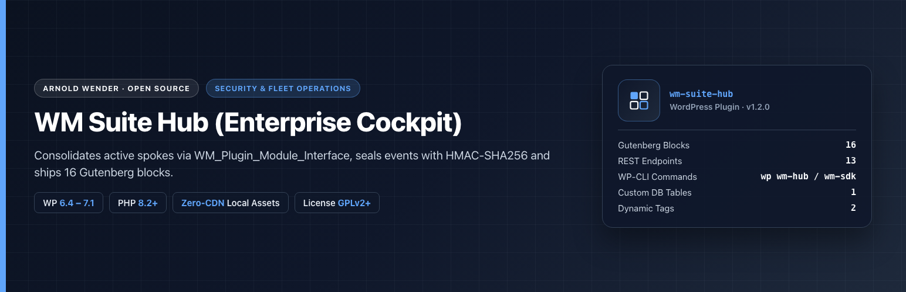
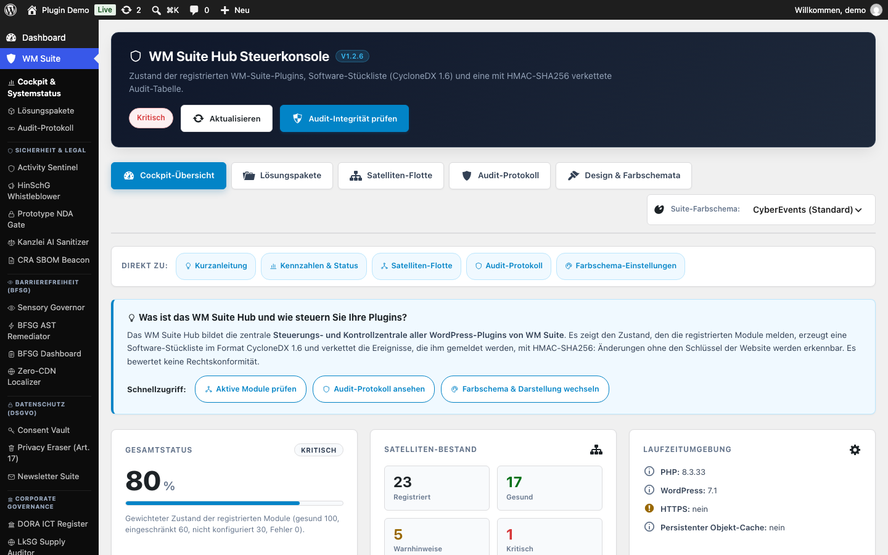

# WM Suite Hub (Português)

  [🇧🇬 Български](README.bg.md) • [🇨🇿 Čeština](README.cs.md) • [🇩🇰 Dansk](README.da.md) • [🇩🇪 Deutsch](../../README.de.md) • [🇬🇷 Ελληνικά](README.el.md) • [🇬🇧 English](../../README.md) • [🇪🇸 Español](../../README.es.md) • [🇪🇪 Eesti](README.et.md) • [🇫🇮 Suomi](README.fi.md) • [🇫🇷 Français](README.fr.md) • [🇮🇪 Gaeilge](README.ga.md) • [🇭🇷 Hrvatski](README.hr.md) [🇭🇺 Magyar](README.hu.md) • [🇮🇹 Italiano](README.it.md) • [🇱🇹 Lietuvių](README.lt.md) • [🇱🇻 Latviešu](README.lv.md) • [🇲🇹 Malti](README.mt.md) • [🇳🇱 Nederlands](README.nl.md) • [🇵🇱 Polski](README.pl.md) • [🇵🇹 Português](README.pt.md) • [🇷🇴 Română](README.ro.md) • [🇸🇰 Slovenčina](README.sk.md) • [🇸🇮 Slovenščina](README.sl.md) • [🇸🇪 Svenska](README.sv.md)

---

  
  
  
  
  

> **Central cockpit for the WM Suite plugin family: a spoke registry, a health matrix, an append-only HMAC-SHA256 audit chain in one table, 16 compiled and server-rendered Gutenberg blocks, Block Bindings and GenerateBlocks 2.x telemetry bridges, a Borlabs Cookie bridge and a solution-pack resolver whose installer answers 501**  
> **Página do plugin:** [https://arnoldwender.com/en/wordpress-plugins/wm-suite-hub/](https://arnoldwender.com/en/wordpress-plugins/wm-suite-hub/)  
> **Desenvolvido com um fluxo de trabalho agêntico:** criado com agentes de programação de IA. Reveja-o e teste-o como qualquer código de terceiros antes de o usar em produção.  
> **Support & Liability:** Zero support — reproducible bugs on [GitHub Issues](https://github.com/arnoldwender/wm-wp-suite-hub/issues) only · no private support · AS IS / no liability ([SUPPORT.md](../../SUPPORT.md))

---

## 📸 Português Enterprise Showcase

---

## 🟢 NÍVEL 1: GUIA DE INÍCIO RÁPIDO PARA INICIANTES (NO-CODE)

### O que este plugin faz pelo seu site?
Central cockpit for the WM Suite plugin family: a spoke registry, a health matrix, an append-only HMAC-SHA256 audit chain in one table, 16 compiled and server-rendered Gutenberg blocks, Block Bindings and GenerateBlocks 2.x telemetry bridges, a Borlabs Cookie bridge and a solution-pack resolver whose installer answers 501

### 🚀 Como começar em 2 minutos (Passo a passo sem código):
1. Install and activate (WordPress 6.4+, PHP 8.2+). Activation creates the audit table, grants `manage_wm_suite` to administrators and registers the `wm_compliance_officer` role. On Multisite networks, when network-activated, `wp_initialize_site` automatically provisions newly created sub-sites.
2. Open **WM Suite > Suite Hub**. Spokes active on the site appear by themselves.
3. Optional: activate Borlabs Cookie to register the consent bridge.

### 💡 Perguntas Frequentes para Iniciantes:
#### ❓ What is not included?
No shortcode; no PDF or CSV export; no public REST route other than the Borlabs consent bridge; no second or third table; no bundle installation; no legal assessment of any kind; no outbound request to any host.

---

## 🟡 NÍVEL 2: GUIA PARA WEBMASTERS E ADMINISTRADORES

### What the plugin does
1. **Spoke registry.** Every WM Suite plugin offers itself through the `wm_register_suite_module` filter or its alias `wm_suite_hub_registered_modules`; `Module_Registry` merges both lists, keeps the objects that implement `WM_Plugin_Module_Interface` and drops the rest. `Health_Matrix` turns their `get_health_status()` into a score, cached in a transient.
2. **Cockpit.** Menu *WM Suite* (`admin.php?page=wm-suite-hub`, capability `manage_wm_suite`, granted to administrators at activation together with the role `wm_compliance_officer`), two dashboard widgets, and a consolidated sidebar: with the hub active, a spoke's own top-level menu is removed and dispatched from the hub instead. The status badge and every module status are the health matrix's own values as translated words (*Gesund*, *Eingeschränkt*, …; an unknown status reads *Unbekannt*), and the runtime card shows the PHP and WordPress versions, HTTPS and the object cache as the matrix read them — only a missing HTTPS carries a warning.
3. **Audit chain.** One table, `{prefix}wm_suite_audit_log` (`timestamp`, `module_slug`, `event_type`, `user_id`, `ip_address`, `payload`, `previous_hash`, `current_hash`). Every event is appended to a linear chain with `HMAC-SHA256( timestamp|module|event|user|ip|payload|previous_hash, wp_salt( 'auth' ) )`; `verify_chain_integrity()` walks the rows in pages of 500 and names the first id whose link or signature does not recompute. A broken signature means the row was changed or the site key (`AUTH_SALT`) is no longer the one it was written with — the message names both. It detects changes made without the site key; it does not make a row true.
4. **Solution packs.** Bundle manifests are parsed, their dependency graph resolved with Kahn's topological sort, and a pre-flight audit checks the environment. `dry_run` returns the resolved order. **Installing is not available in this version:** `POST /marketplace/install-bundle` without `dry_run` answers `501` and writes nothing, because the signing root key is an open decision (D9).
5. **Gutenberg & dynamic bindings.** 16 server-rendered blocks (`block.json`, `apiVersion` 3, `editorScript: wm-suite-hub-blocks-editor` compiled in `build/index.js`) under the category `wm-suite`, registered with `register_block_type_from_metadata()` and live `ServerSideRender` previews. In addition, `Telemetry_Bridge` registers the WordPress 6.5+ Block Bindings source `wm-suite-hub/telemetry` and the GenerateBlocks 2.x Dynamic Tag `wm_hub_telemetry` exposing aggregate suite health score, active spoke count, status label, and hub version (empty when the hub cannot compute them). Each block, with its attributes and defaults: **[docs/BLOCKS.md](../../docs/BLOCKS.md)**. No block checks what it shows: four show the output of another WM Suite plugin through its shortcode and `wm/consent-badge` opens that consent vault's dialog, `wm/event-grid` lists the active events of WM Cyber Events Core (`CyberEvents_Database::get_active_events()`), and the other ten print the values typed into the editor. 13 render nothing for visitors while their plugin is missing or a required setting is empty, and tell editors what is missing.
6. **Borlabs Cookie bridge.** Its REST route and frontend script are registered only when Borlabs Cookie is detected. When a visitor saves a decision in the Borlabs dialog (event `borlabs-cookie-consent-saved`), the script calls `POST /wp-json/wm-suite/v1/consent-sync`; behind the REST nonce and a rate limit of 10 requests per minute per client, the route reads the decision from the `borlabs-cookie` cookie the request carries — the accepted service groups with their services, and Borlabs' own consent uid — and appends one entry with an anonymised IP and a bounded user agent (at most 50 groups of at most 50 services). Without a readable decision it writes nothing and answers `400`. It does not configure Borlabs: no services, content blockers or texts are registered there. Measured against Borlabs Cookie 3.4; the 2.x event name is not verified. The `wm_compliance_has_consent` filter reads the same cookie when WM Sovereign Consent Vault is not active: a category is a Borlabs service group (`external_media` also matches `external-media`) or a single service.
7. **Asset deduplication.** When two plugins enqueue the same family sheet, only the canonical one stays; a spoke's legacy `*-admin-obsidian` copy is dropped only while `wm-admin-ui` is on the page.
8. **Design family.** `assets/css/wm-admin-tokens.css` and `assets/css/wm-admin-ui.css` are the canonical sheets every WM plugin bundles byte-identically; `wp-plugin-fleet-ui-sync.py` propagates them and writes each plugin's `tests/test-ui-family.php`, which pins their MD5.

### Not shipped
No shortcode; no PDF or CSV export; no public REST route other than the Borlabs consent bridge; no second or third table; no bundle installation; no legal assessment of any kind; no outbound request to any host.

---

## 🔴 NÍVEL 3: GUIA PARA DESENVOLVEDORES E ARQUITETOS DE SOFTWARE

Classes, hooks, options, the admin screen and the WM Suite Hub adapter are documented in the English manual: **[DEVELOPERS.md](../../DEVELOPERS.md)**.

---

## ⚖️ Conformidade Legal e Regulamentar Europeia

- **What the plugin establishes:** which WM Suite plugins are active and what health they report, and that the rows of its own audit table were not changed, removed or reordered without the site key. It does not assess DSGVO, TDDDG, CRA, DORA, HinSchG or GoBD, and it does not make a site compliant with any of them.
- **Outbound requests:** none.
- **Personal data:** the audit table stores the user id, an IP address (anonymised for the consent bridge) and the payload each event carries; nothing is sent anywhere.

---

## 🔒 Licença e Direitos de Propriedade

Distributed under the **GNU General Public License v2 or later**.  
Copyright (C) 2026 Arnold Wender.  
